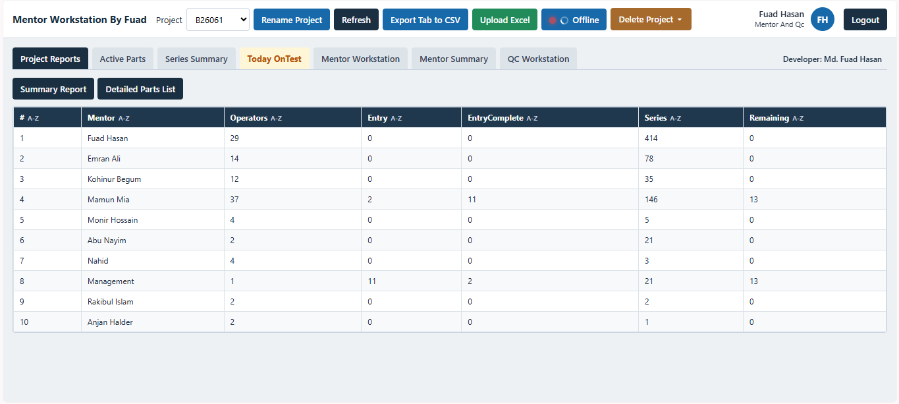
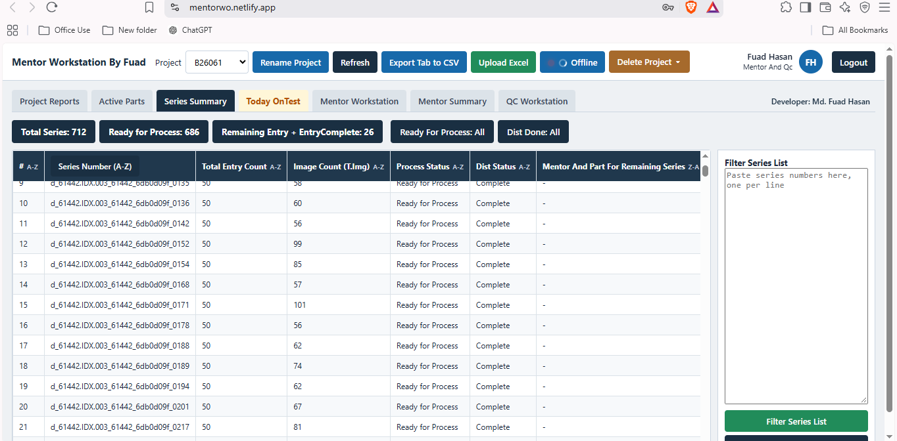
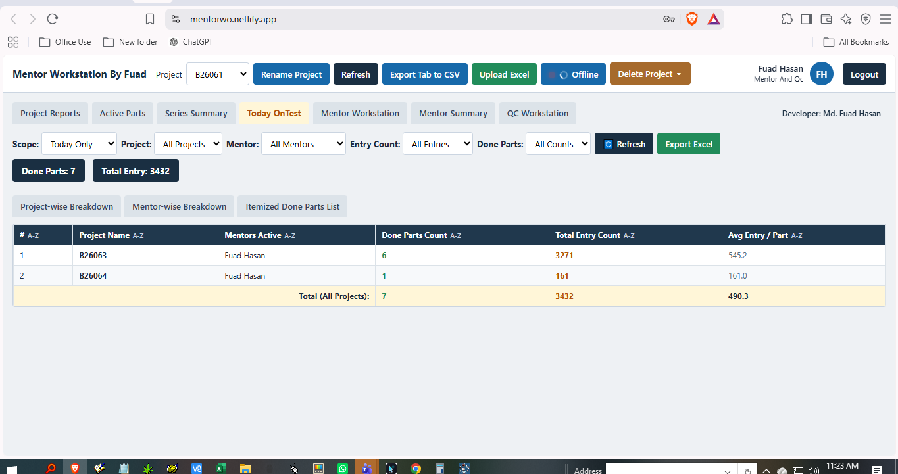
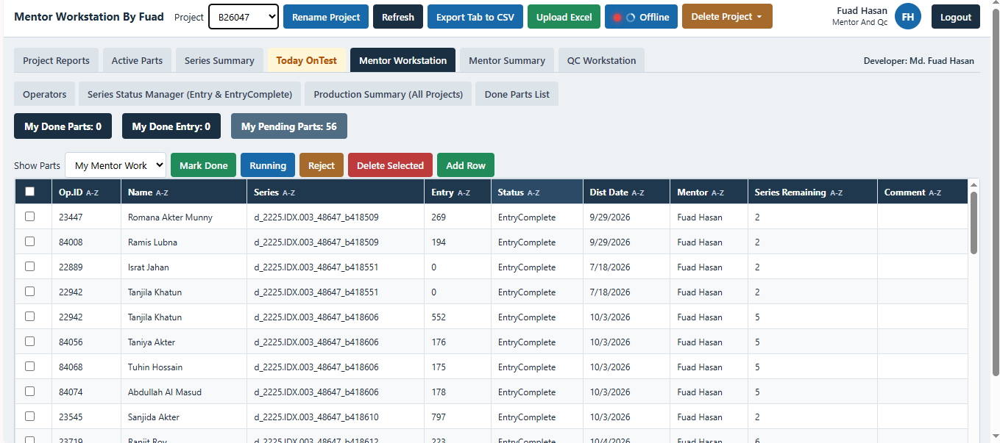
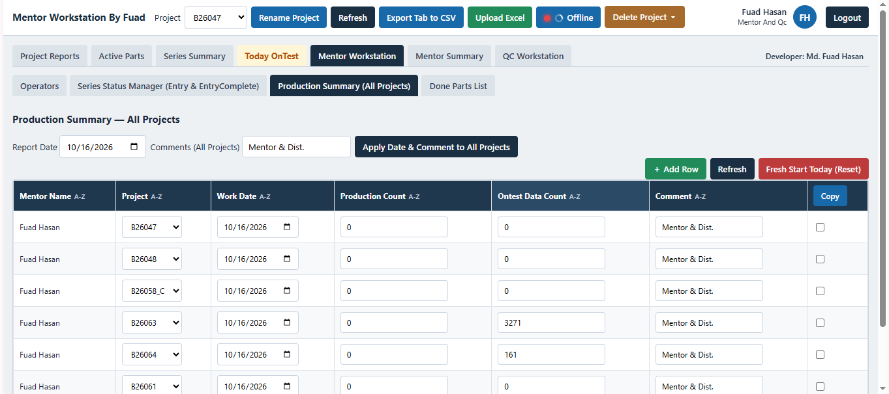
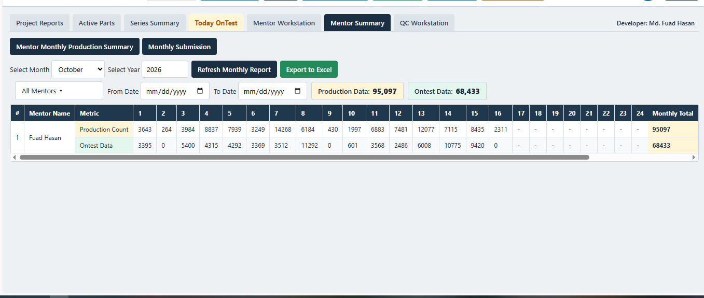

<h1 align="center">📊 Mentor Workstation By Fuad</h1>

<p align="center">
  <em>A comprehensive, web-based production and project management dashboard designed to streamline operator data entry tracking, mentor workflows, and series status management.</em>
</p>

<p align="center">
  <strong>Live Demo:</strong> <a href="https://mentorwo.netlify.app">mentorwo.netlify.app</a><br>
  <strong>Developer:</strong> Md. Fuad Hasan
</p>

---

## 📸 Dashboard Overview


---

## ✨ Key Features

Based on the robust dashboard interfaces, this application provides extensive tools for data monitoring and project management across multiple dedicated workstations:

### 📑 Comprehensive Reporting & Workstations

* **Project Reports:** High-level summary of active mentors, total operators, entry counts, completed entries, and remaining series per project.
* **Series Summary:** Detailed tracking of individual series numbers, total entry/image counts, process status (e.g., "Ready for Process"), and distribution status. Includes a bulk series filter utility.
* **Today OnTest:** Real-time daily tracking of "Done Parts" and "Total Entries," featuring project-wise and mentor-wise breakdowns with average entry calculations.
* **Mentor Workstation:** A dedicated workspace to manage operator tasks. Mentors can track specific operator IDs, mark parts as Done, Running, or Rejected, and view pending parts. 
* **Mentor Summary (Monthly):** Granular, day-by-day tracking of Production Data and Ontest Data for specific months and years, calculating monthly totals automatically.

### 🛠️ Data Management Tools

* **Excel Integration:** Easily "Upload Excel" data to populate the dashboard and "Export Tab to CSV" or "Export Excel" to generate reports for stakeholders.
* **Real-time Controls:** Toggle Offline/Online status, Rename Projects, and Delete Projects directly from the top navigation bar.
* **Advanced Filtering:** Filter views by Specific Dates, Projects, Mentors, Entry Counts, and Done Parts.

---

## 🖼️ Interface Previews

### 1. Summary Report
Provides a bird's-eye view of mentor allocations, operator counts, and overall project progress.


### 2. Series Summary
Manages the life-cycle of image series, tracking readiness and distribution.


### 3. Today OnTest
Monitors daily targets and throughput averages across different projects.


### 4. Mentor Workstation (Series Status Manager)
The core operational tab where mentors approve, reject, or track pending operator entries.


### 5. Production Summary
Allows batch updates of work dates and comments across multiple mentor projects simultaneously.


### 6. Mentor Summary (Monthly Submission)
A 31-day grid view summarizing overall mentor performance and data processing metrics.


---

## 🚀 Getting Started

To run this dashboard locally, ensure you have a standard web server or Node.js environment configured.

### Installation

1. **Clone the repository:**
   ```bash
   git clone https://github.com/itsfuad41/Mentor-Workspaces-GHIT.git
   cd Mentor-Workspaces-GHIT
   ```

2. **Launch the Application:**
   Because this is a static web application hosted on Netlify, you can simply open the `index.html` file in your browser, or run a local development server:
   ```bash
   npx serve .
   ```

3. Open your browser and navigate to `http://localhost:3000`.

---

## 🏗️ Technology Stack

* **Frontend:** HTML5, CSS3, JavaScript
* **Deployment:** Netlify (`mentorwo.netlify.app`)
* **Data Handling:** Client-side CSV/Excel parsing and generation tools.
* **UI/UX:** Tabbed navigation, responsive data tables, sticky headers, and specific data-driven color coding.

---

## 👨‍💻 Author

**Md. Fuad Hasan**
* Role: Mentor and QC / Developer
* GitHub: [@itsfuad41](https://github.com/itsfuad41)

*For feature requests, bug reports, or database updates, please open an issue or submit a pull request on the repository.*
