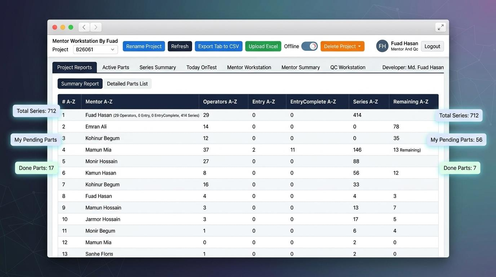

# 🚀 Mentor Workspaces — GHIT

> A comprehensive, multi-role collaborative mentorship and workspace management platform built for structured technical training, cohort tracking, and real-time mentor-mentee collaboration at **Golden Harvest InfoTech (GHIT)**.



---

## 🌟 Overview

**Mentor-Workspaces-GHIT** is designed to streamline technical mentorship programs, track mentee progress, manage workspace allocations, and coordinate daily production and learning milestones. The platform provides segregated, high-performance dashboards tailored for administrators, mentors, operators, and mentees, backed by a secure PostgreSQL database and robust API synchronization.

---

## 📊 System Previews

Here is a look at the various reporting and workspace management modules available in the platform:

### 1. Today OnTest Summary
Tracks active daily entries and series remaining.


### 2. Series Summary
Monitors ready-for-process data and distribution status.


### 3. Mentor-Wise Breakdown
Shows itemized parts done and total entry counts across projects.


### 4. Mentor Workstation (Task Management)
Detailed tracking of pending parts, status, and direct mentor assignments.


### 5. Production Summary (All Projects)
Aggregates daily production and OnTest data across different projects for easy reporting.


### 6. Mentor Monthly Production Summary
Comprehensive monthly view of production counts and testing data over time.


---

## 🏛️ Role-Based Dashboards & Architecture

The application is structured around four distinct operational tiers:

| Role | Access & Key Responsibilities |
| :--- | :--- |
| **🛡️ Admin Dashboard** | Complete platform oversight, user management, role assignments, system-wide analytics, and audit logs. |
| **👨‍🏫 Mentor Dashboard** | Cohort management, review and grading of mentee submissions, session scheduling, and performance tracking. |
| **⚙️ Operator Dashboard** | Operational workflow monitoring, daily entry verification, resource management, and workspace coordination. |
| **💻 Mentee Workspace** | Personal task tracker, submission portal, resource repository, and direct feedback channel with assigned mentors. |

---

## 🛠️ Tech Stack

- **Frontend:** Responsive web interfaces built with modern HTML5, CSS3, JavaScript, and Flutter multi-platform support.
- **Backend & Database:** Supabase PostgreSQL with secure Row Level Security (RLS) policies and REST API synchronization.
- **Security & Auth:** Token-based authentication, role-based access control (RBAC), and secure local-to-cloud network tunneling.
- **Tooling:** Automated version checking (`version.json`), custom global hotkey listeners, and modular standalone build configurations.

---

## ⚙️ Getting Started & Installation

### Prerequisites
- Node.js (v18+ recommended) or Python 3.10+ (for local automation scripts)
- Supabase account & project instance configured with PostgreSQL

### 1. Clone the Repository
```bash
git clone https://github.com/itsfuad41/Mentor-Workspaces-GHIT.git
cd Mentor-Workspaces-GHIT
```

### 2. Environment Configuration
Create a `.env` file in the root directory and configure your Supabase credentials:
```env
SUPABASE_URL=your_supabase_project_url
SUPABASE_ANON_KEY=your_supabase_anon_key
PORT=3000
```

---

## 🔒 Security & Row Level Security (RLS)

All database interactions enforce strict security standards:
- **Row-Level Security (RLS):** Enabled across all tables to ensure users only access data permitted by their assigned role.
- **REST API Authentication:** Secure token validation on every endpoint request.
- **Encrypted Local Storage:** Sensitive configurations and session tokens are stored securely with restricted access permissions.

---

## 🤝 Contributing

Contributions, issues, and feature requests are welcome! 
1. Fork the Project (`https://github.com/itsfuad41/Mentor-Workspaces-GHIT/fork`)
2. Create your Feature Branch (`git checkout -b feature/AmazingFeature`)
3. Commit your Changes (`git commit -m 'Add some AmazingFeature'`)
4. Push to the Branch (`git push origin feature/AmazingFeature`)
5. Open a Pull Request

---
*Maintained with ❤️ by [Md. Fuad Hasan](https://github.com/itsfuad41)*
